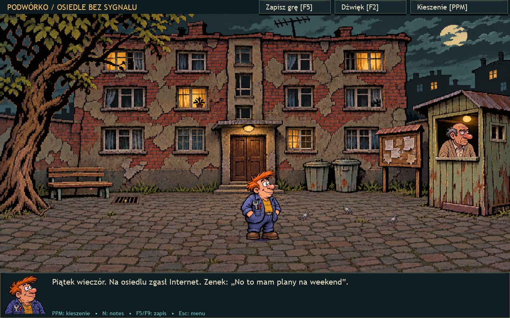

# Misja Zenka — Router Ostateczny

Humorystyczna przygodówka point-and-click na Windows, w klimacie dawnych gier amigowych.
Na osiedlu pada Internet. Zenek musi porozmawiać z sąsiadami, znaleźć potrzebne części
i uruchomić sieć.

## Pobierz i uruchom

**[Pobierz MisjaZenka.exe](https://github.com/erwinsts/Misja-Zenka/releases/latest/download/MisjaZenka.exe)**

Pobierz EXE i uruchom go. Grafika, muzyka i dźwięki są w środku.
Nie trzeba instalować Pythona ani pobierać dodatkowych plików. Gra działa offline.

## W grze

- Cztery lokacje: podwórko, kiosk, piwnica i serwerownia.
- Rozmowy z postaciami, zbieranie przedmiotów i łączenie ich w użyteczne narzędzia.
- Pikselowa grafika, animowane przedmioty i zmieniający się wygląd naprawianych urządzeń.
- Trzy własne dramatyczne motywy muzyczne.
- Zapis i odczyt stanu gry.

## Sterowanie

| Klawisz / przycisk | Działanie |
| --- | --- |
| Lewy przycisk myszy | Podejdź, zbierz, porozmawiaj lub użyj obiektu |
| Prawy przycisk myszy | Otwórz / zamknij kieszenie; zakończ rozmowę |
| Dwa przedmioty w kieszeniach | Spróbuj je połączyć |
| F5 / przycisk „Zapisz grę” | Zapisz grę |
| F9 / „Wczytaj zapis” | Wczytaj grę |
| N | Notes |
| F2 | Ustawienia dźwięku |
| M | Wyciszenie |
| F11 | Pełny ekran |
| Esc | Menu |

Zapisy znajdują się w `%LOCALAPPDATA%\MisjaZenka\zapis.json`.

## Wydanie

Pierwsze publiczne wydanie obejmuje jedną kompletną misję. Udostępniany jest samodzielny
program Windows, bez kodu źródłowego.

Ilustracje przygotowano z pomocą imagegen. Melodie i aranżacje są własne; nagrania
instrumentów pochodzą z [GeneralUser GS, S. Christiana Collinsa](https://schristiancollins.com/generaluser.php),
a muzykę wyrenderowano przez FluidSynth.
